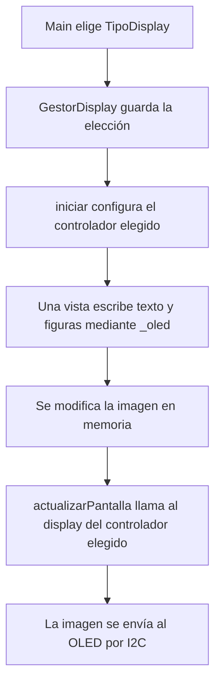

# Cómo funciona el gestor de pantalla

Guía para estudiar el código y explicarlo en la defensa. Describe la implementación actual de `GestorDisplay` y su integración prevista con el resto del proyecto.

## Qué está implementado y qué falta

Las vistas de pantalla y la selección entre SSD1306 y SH1106 están implementadas. Se comprobó la compilación del firmware eligiendo cada controlador. La pantalla física y la ejecución en Wokwi todavía requieren prueba.

**Telegram está integrado:** sus comandos de display invocan las vistas de esta biblioteca y consultan el estado actual de sensores y actuadores.

Las pruebas nativas comprueban sensores, actuadores y lógica de comunicación simulada; no comprueban el funcionamiento físico del OLED.

## La idea general

El main coordina el sistema mediante llamadas. En `setup()` inicializa los módulos; en `loop()` actualiza sensores, actuadores, Wi-Fi, el indicador azul, ThingSpeak y Telegram. La lógica de cada componente queda en su biblioteca.

Para la pantalla, el resto del programa trabaja con un único objeto llamado `display`, de la clase `GestorDisplay`. Sus funciones expresan qué información queremos mostrar:

```cpp
display.mostrarEstadoLed(...);
display.mostrarEstadoPotenciometro(...);
display.mostrarEstadoDht(...);
```

Los puntos suspensivos de este fragmento representan los argumentos; es un esquema, no código para copiar y compilar.

Dentro del gestor se resuelve cómo comunicarse con el controlador seleccionado. Los textos y figuras de cada vista se escriben una sola vez.

## 1. Elegimos el modelo en main

En [main.cpp](../src/main.cpp) está esta declaración:

```cpp
GestorDisplay display(TipoDisplay::SSD1306);
```

Se lee: “crear un gestor llamado display y configurarlo para SSD1306”. Para un módulo SH1106, se reemplaza esa línea por:

```cpp
GestorDisplay display(TipoDisplay::SH1106);
```

Se utiliza **una sola declaración**. La opción actual es SSD1306 para el diagrama Wokwi del proyecto. El kit físico debe verificarse: los ejemplos de la cátedra usan SH1106, lo que sirve de referencia, pero no identifica por sí solo la pantalla conectada.

`TipoDisplay` es un `enum class`: un tipo que contiene las dos opciones con nombre. Evita elegir el modelo mediante números sin significado. No es un detector automático de hardware. La elección se hace antes de compilar y queda fija para esa instancia.

## 2. El constructor prepara los objetos

En [GestorDisplay.h](../lib/GestorDisplay/GestorDisplay.h) están los miembros principales:

| Miembro | Para qué sirve |
| --- | --- |
| `_tipo` | Guarda SSD1306 o SH1106, según lo que eligió main. |
| `_ssd1306` | Objeto de la biblioteca Adafruit para SSD1306. |
| `_sh1106` | Objeto de la biblioteca Adafruit para SH1106. |
| `_oled` | Referencia a las funciones gráficas del objeto elegido. |
| `_inicializado` | Indica si la inicialización de la biblioteca terminó correctamente. |

El constructor está en [GestorDisplay.cpp](../lib/GestorDisplay/GestorDisplay.cpp). Crea los dos objetos de controlador y relaciona `_oled` con uno de ellos. Todavía no ejecuta el `begin()` de ninguno: eso ocurre después, al llamar a `iniciar()`.

Los nombres que empiezan con guion bajo son una convención para reconocer los miembros internos de esta clase.

## 3. Qué significa la referencia a Adafruit_GFX

La declaración que puede resultar menos familiar es:

```cpp
Adafruit_GFX &_oled;
```

`Adafruit_GFX` es la base gráfica que comparten las bibliotecas de ambos controladores. Permite usar funciones como `setCursor()`, `print()`, `drawLine()` y `drawRect()`.

El símbolo `&` indica que `_oled` es una **referencia**: otro nombre para acceder al objeto elegido a través de esa base gráfica. No crea una tercera pantalla ni copia la imagen.

En el constructor se hace esta elección:

```cpp
_oled(tipo == TipoDisplay::SSD1306
          ? static_cast<Adafruit_GFX &>(_ssd1306)
          : static_cast<Adafruit_GFX &>(_sh1106))
```

Este fragmento pertenece a la lista de inicialización del constructor. El operador `condición ? opciónA : opciónB` elige la primera opción cuando la condición es verdadera y la segunda cuando es falsa.

`static_cast<Adafruit_GFX &>(...)` permite acceder al controlador mediante su parte gráfica común. No transforma un SH1106 en SSD1306 ni cambia el modelo físico. Los controladores siguen siendo distintos; las operaciones gráficas terminan usando el código del objeto seleccionado.

Por eso podemos escribir una sola vez:

```cpp
_oled.setCursor(0, 18);
_oled.println(F("Led encendido"));
```

La misma vista se utiliza con cualquiera de las dos pantallas. Los valores de color empleados son 0 para negro y 1 para blanco en estas dos bibliotecas monocromáticas.

## 4. iniciar() configura el controlador elegido

El main llama a:

```cpp
display.iniciar();
```

Esta función realiza los siguientes pasos:

1. Inicia I²C con SDA y SCL definidos en `Configuracion.h`.
2. Comprueba que un dispositivo responda en la dirección I²C configurada.
3. Según `_tipo`, ejecuta el `begin()` de SSD1306 o el de SH1106.
4. Si falta la respuesta I²C o la biblioteca informa error, devuelve `false` y deja `_inicializado` en falso.
5. Si termina correctamente, habilita las vistas y muestra la bienvenida.

Existen dos objetos de controlador, pero **solo se inicializa el elegido**. No se prueban automáticamente los dos modelos ni se manejan dos pantallas conectadas a la vez.

`_inicializado` sirve para que las vistas no dibujen antes de preparar el controlador. Un retorno exitoso de la biblioteca no confirma por sí solo que el controlador físico sea el correcto; hay que observar la imagen en la pantalla.

`estaInicializado()` permite que Telegram informe que la pantalla no está disponible. La respuesta I²C comprueba que hay un dispositivo en esa dirección, pero no identifica su controlador ni garantiza que la imagen sea visible.

## 5. Dibujar y enviar la imagen son pasos diferentes

Las funciones gráficas modifican una imagen guardada en memoria, llamada buffer. Para que esos cambios aparezcan en el OLED hay que enviarlos al dispositivo.

Cada vista prepara el contenido y termina llamando a:

```cpp
actualizarPantalla();
```

Ese método utiliza `_tipo` para ejecutar `_ssd1306.display()` o `_sh1106.display()`. Esta es una operación específica de cada controlador, por eso no se hace mediante la referencia gráfica `_oled`.



Las vistas LED, potenciómetro, DHT y comando desconocido comparten ese mismo recorrido.

## 6. Cómo se conecta Telegram

La interfaz actual de `GestorTelegram` recibe este parámetro:

```cpp
GestorDisplay &display
```

Aquí `&` también significa referencia: Telegram recibe acceso al mismo gestor que creó main, no una copia. La clase `GestorDisplay` es la misma para ambos controladores, así que la firma de Telegram no necesita cambiar al elegir otra pantalla.

Para `/displayled`, el manejador ejecuta una llamada de esta forma:

```cpp
display.mostrarEstadoLed(
    actuadores.estaReleEncendido(),
    actuadores.estaLedAzulEncendido(),
    actuadores.segundosRestantesRele());
```

Telegram pedirá mostrar el estado del LED. `GestorDisplay` se encargará de dibujar y enviar la imagen con el controlador elegido. Al pasar de SSD1306 a SH1106, esa llamada será idéntica.

## Guion breve para la defensa

> Elegimos el modelo de pantalla al crear el gestor en el main. El gestor tiene preparados los controladores SSD1306 y SH1106, pero inicializa únicamente el seleccionado. Ambos comparten las funciones gráficas de Adafruit_GFX, por lo que usamos una referencia al controlador elegido para dibujar los mismos textos y figuras. Al terminar cada vista, una función envía la imagen con el controlador correspondiente. Esto permite cambiar el modelo en una sola línea del main y conservar las llamadas del resto del programa. Telegram utiliza una referencia a este gestor.

## Preguntas que conviene saber responder

**¿Dónde se cambia el modelo?** En la declaración de `display` en main, modificando `TipoDisplay::SSD1306` por `TipoDisplay::SH1106` o viceversa. Después se vuelve a compilar y cargar el firmware.

**¿Por qué no alcanza con que responda en 0x3C?** La dirección identifica un dispositivo del bus, pero no confirma qué controlador utiliza. Hay que confirmar el modelo y probar la imagen.

**¿Por qué usamos una referencia?** Para acceder al objeto seleccionado sin copiarlo y usar sus funciones gráficas comunes.

**¿Por qué hay un método separado para enviar la imagen?** Porque las funciones gráficas preparan el buffer, mientras que cada controlador tiene su propia operación para transferirlo a la pantalla.

**¿Qué se reutiliza?** El código de todas las vistas y la interfaz que usan main y el manejador de Telegram.

**¿Qué falta demostrar?** La pantalla física, el funcionamiento en Wokwi y los recorridos con los servicios de red. Compilar ambas selecciones no demuestra la integración completa del TP.
