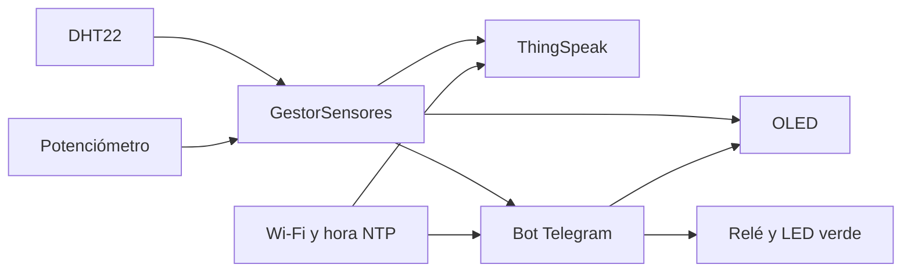
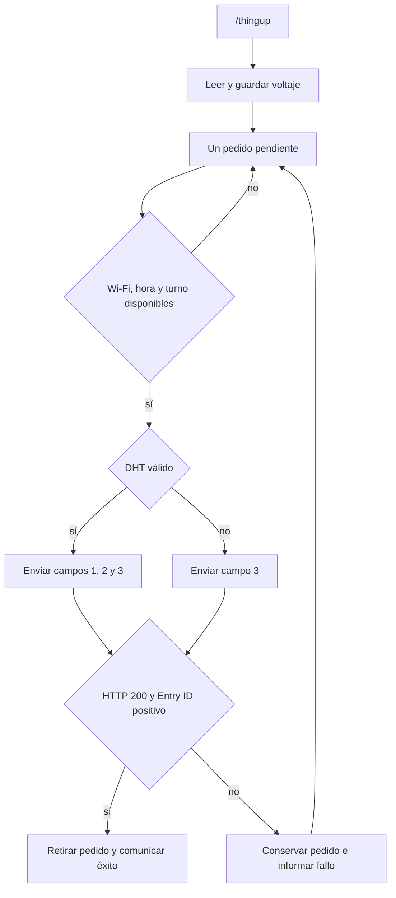

# Guía de estudio y exposición: supervisión ambiental con ESP32

**Base:** código de `78b9d16` y cambios posteriores del 12 de noviembre de 2026 para controlar el relé y el LED verde. Esta guía distingue las pruebas locales históricas de las verificaciones que todavía requieren servicios o hardware. Para una lectura rápida, empezar por el resumen y el guion; para defender decisiones, seguir los enlaces al código.

## Índice

- [Resumen de un minuto](#resumen-de-un-minuto)
- [Problema y arquitectura](#problema-y-arquitectura)
- [Decisiones de diseño](#decisiones-de-diseño)
- [Tecnologías y conexiones](#tecnologías-y-conexiones)
- [Mapa de archivos y responsabilidades](#mapa-de-archivos-y-responsabilidades)
- [Recorrido de ejecución](#recorrido-de-ejecución)
- [Sensores y alarma](#sensores-y-alarma)
- [Actuador y temporizador](#actuador-y-temporizador)
- [Pantalla OLED](#pantalla-oled)
- [Wi-Fi, hora y seguridad de transporte](#wi-fi-hora-y-seguridad-de-transporte)
- [Telegram y comandos](#telegram-y-comandos)
- [ThingSpeak y confirmación de escritura](#thingspeak-y-confirmación-de-escritura)
- [Bibliotecas y herramientas](#bibliotecas-y-herramientas)
- [Glosario para leer el código](#glosario-para-leer-el-código)
- [Compilación, pruebas y estado](#compilación-pruebas-y-estado)
- [Demostración sugerida](#demostración-sugerida)
- [Guion de 10 a 15 minutos](#guion-de-10-a-15-minutos)
- [Preguntas para practicar](#preguntas-para-practicar)
- [Qué afirmar en la defensa](#qué-afirmar-en-la-defensa)
- [Límites y mejoras](#límites-y-mejoras)
- [Fuentes](#fuentes)

## Resumen de un minuto

El proyecto supervisa temperatura, humedad y un voltaje con una ESP32. Muestra información en una OLED, permite consultar y accionar una salida desde un bot de Telegram y publica mediciones en ThingSpeak. El DHT22 proporciona clima y el potenciómetro simula una magnitud analógica. Una alarma se genera cuando el voltaje alcanza 2,50 V; la histéresis y la espera entre eventos reducen avisos repetidos.

El programa divide responsabilidades en gestores. `setup()` los inicia y `loop()` llama sus métodos de actualización. El relé y el LED verde reciben la misma orden, temporizada con `esp_timer` para poder apagarse aunque el ciclo principal esté esperando a la red. La comunicación con los servicios usa HTTPS y validación de certificado. Las pruebas nativas verifican lógica con periféricos y red simulados; todavía hay que confirmar el comportamiento integral en el montaje físico y con los servicios reales.

## Problema y arquitectura

Se busca observar variables ambientales localmente y a distancia, registrar mediciones y ejecutar una acción remota acotada en el tiempo. Se usan tecnologías y API presentes en ejemplos de la materia UV, adaptadas a una integración por gestores y reintentos sin un `while` esperando conexión. La separación permite ubicar cada decisión y probar partes sin necesitar todos los dispositivos conectados.



El diagrama muestra flujos de información: los sensores alimentan vistas, publicaciones y alertas; Telegram también solicita acciones. Los gestores coordinan estas relaciones desde [`main.cpp`](../src/main.cpp), no hay una conexión directa entre todos los componentes físicos.

## Decisiones de diseño

| Decisión | Motivo | Límite a explicar |
| --- | --- | --- |
| Separar en gestores | Agrupar responsabilidades y hacer navegable y comprobable la lógica. | Los módulos siguen coordinándose desde el ciclo principal. |
| Una referencia GFX para dos controladores OLED | Compartir el dibujo entre SSD1306 y SH1106. | Se selecciona el modelo manualmente; el ACK no lo identifica. |
| HTTPClient sobre HTTPS para ThingSpeak | Utilizar la API web y validar el servidor con TLS. | La petición es síncrona y depende de red, hora y certificado. |
| `esp_timer` para la salida temporizada | Cumplir el apagado sin depender de que `loop()` termine una espera de red. | La ejecución del callback puede demorarse; el resto del sistema no es completamente asíncrono. |
| Una instantánea pendiente y combinar campos | Respetar el turno de escritura y publicar clima con voltaje cuando hay datos válidos. | Un pedido nuevo reemplaza al anterior y se pierde al reiniciar. |
| Mínimo compartido de 15.500 ms e intervalo de clima independiente | Espaciar intentos y mantener una cadencia propia de clima. | El resultado puede tardar; el intervalo compartido corre desde el fin del intento. |
| Timeouts de 10 s por fase | Acotar esperas configurables de conexión y respuesta. | No garantizan un máximo de 10 s para la operación completa. |
| Bandera de validez DHT | Evitar publicar como actuales valores conservados tras una falla. | No sustituye un diagnóstico eléctrico del sensor. |
| Histéresis y cooldown | Evitar alternancias y limitar frecuencia de alertas. | El muestreo puede perder cruces breves si el ciclo se demora. |
| Autorizar por ID de chat | Restringir órdenes a un destino configurado. | Un grupo autorizado comparte esa autorización entre sus integrantes. |
| Exportar desde una sola fuente | Reutilizar el código para PlatformIO y Arduino sin compilar `main.cpp` dos veces. | La copia generada debe regenerarse tras cambios. |

La consigna original puede consultarse en [el PDF del TPI](<TA4k01-TPI%20-%2002.pdf>). Al explicar el requisito de funcionamiento sin bloqueo, precisar el alcance conseguido: el apagado temporizado no depende del avance de `loop()`; las operaciones de red sí pueden detener temporalmente ese ciclo.

## Tecnologías y conexiones

| Elemento | Función en el proyecto | Conexión o detalle |
| --- | --- | --- |
| ESP32 DOIT DevKit V1 | Ejecuta el firmware y aporta GPIO, ADC y Wi-Fi | Placa seleccionada en [PlatformIO](../platformio.ini) |
| DHT22 | Mide temperatura y humedad | GPIO 33; lectura digital mediante su biblioteca |
| Potenciómetro | Produce un voltaje variable para medir y disparar alerta | GPIO 32, ADC1; resolución configurada de 12 bits |
| Relé | Recibe la orden del actuador | GPIO 14; nivel activo HIGH elegido, pendiente de validación física |
| LED verde | Indica la misma orden del relé | GPIO 23; salida separada escrita consecutivamente |
| LED azul | Indica estado observado de conexión Wi-Fi | GPIO 2; no garantiza acceso a Internet |
| OLED 128 × 64 | Muestra bienvenida y vistas pedidas por Telegram | I²C: SDA 21, SCL 22, dirección `0x3C` |

Las constantes están en [`Configuracion.h`](../lib/Configuracion/Configuracion.h) y el montaje simulado en [`diagram.json`](../diagram.json). En Wokwi los sensores y la pantalla se alimentan desde 3V3. Antes de probar la placa real hay que confirmar cableado, modelo de pantalla, tensiones y conexión del actuador.

**Conceptos:** I²C comparte líneas de datos y reloj entre dispositivos direccionados. El ADC convierte una entrada analógica en un número digital. HTTP transporta las peticiones a los servicios; HTTPS agrega TLS para cifrar y autenticar al servidor mediante certificados. NTP solicita la hora por red, necesaria para validar vigencia de certificados. Wokwi simula el montaje, mientras PlatformIO configura y compila el proyecto. Arduino aporta el framework y C++ permite organizarlo en clases y bibliotecas.

## Mapa de archivos y responsabilidades

| Acción o requisito | Dónde buscar | Funciones o decisión |
| --- | --- | --- |
| Crear componentes y ejecutar el ciclo | [`src/main.cpp`](../src/main.cpp) | Instancias globales; `setup()` y `loop()` solo llaman funciones/métodos |
| Pines, umbrales y tiempos | [`Configuracion.h`](../lib/Configuracion/Configuracion.h) | Constantes y selección de credenciales |
| Leer clima, ADC y generar alerta | [`GestorSensores.cpp`](../lib/GestorSensores/GestorSensores.cpp) | `actualizar`, `leerDht`, `leerPotenciometro`, `consumirEventoAlertaCritica` |
| Encender, apagar y temporizar | [`GestorActuadores.cpp`](../lib/GestorActuadores/GestorActuadores.cpp) | `encenderReleTemporizado`, `alVencerTemporizador`, `apagarSiVencido`, `apagarRele` |
| Dibujar vistas | [`GestorDisplay.cpp`](../lib/GestorDisplay/GestorDisplay.cpp) | `iniciar`, `mostrarEstadoLed`, `mostrarEstadoPotenciometro`, `mostrarEstadoDht` |
| Conectar y recuperar Wi-Fi | [`GestorWifi.cpp`](../lib/GestorWifi/GestorWifi.cpp) | `iniciar`, `actualizar`, `intentarConexion`; solicita hora al conectar |
| Recibir órdenes, responder y alertar | [`GestorTelegram.cpp`](../lib/GestorTelegram/GestorTelegram.cpp) | `actualizar`, `procesarComando`, `procesarCallback`, `enviarAlertaPendiente` |
| Validar el tiempo de `/releon` | [`ComandoRele.h`](../include/ComandoRele.h) | `parsearComandoRele` valida el texto completo y evita desbordamiento |
| Publicar en la nube | [`GestorThingSpeak.cpp`](../lib/GestorThingSpeak/GestorThingSpeak.cpp) | `actualizar`, `programarEnvioVoltaje`, `realizarPeticion` |
| Configurar dependencias y pruebas | [`platformio.ini`](../platformio.ini) | Entornos ESP32, `native` y `native_thingspeak` |
| Generar sketch de Arduino | [`exportar_arduino.py`](../scripts/exportar_arduino.py) | Copia las fuentes al formato de sketch; [instrucciones](arduino_ide.md) |

Cada gestor tiene también una cabecera `.h` con su interfaz y estado. Por ejemplo, [`GestorSensores.h`](../lib/GestorSensores/GestorSensores.h) declara los getters y [`GestorTelegram.h`](../lib/GestorTelegram/GestorTelegram.h) declara los métodos internos del bot. La interfaz permite que otros módulos usen una capacidad sin duplicar su implementación.

## Recorrido de ejecución

1. Las instancias globales se construyen con los pines y el tipo de pantalla seleccionados.
2. `setup()` abre Serial a 115200 e inicia sensores, actuadores, display, Wi-Fi, ThingSpeak y Telegram, en ese orden.
3. Cada vuelta de `loop()` actualiza sensores y actuadores, observa Wi-Fi, fija el LED azul, procesa Telegram y actualiza ThingSpeak.
4. Los intervalos con `millis()` deciden cuándo corresponde trabajar; la resta de tiempos sin signo permite manejar el desbordamiento del contador en esos intervalos.
5. El apagado temporizado tiene su propio callback `esp_timer`. Las operaciones de red, en cambio, son síncronas y pueden demorar las siguientes vueltas del ciclo.

No conviene describir todo el sistema como «no bloqueante»: no se espera con un `while` para Wi-Fi ni se usa `delay()` para espaciar las tareas propias, pero las llamadas de red y del SDK pueden esperar. Durante esas esperas puede retrasarse el muestreo y perderse un cruce de umbral muy breve.

## Sensores y alarma

`GestorSensores::iniciar()` configura el DHT22 y el ADC, y hace una lectura inicial. `actualizar()` solicita normalmente una lectura del potenciómetro cada 250 ms y una del DHT cada 2500 ms, siempre que el ciclo avance. Los comandos `/thingup` y `/displaypot` fuerzan una lectura del potenciómetro.

El ADC se configura en 12 bits: el valor bruto sirve para el porcentaje y la barra de la OLED. El voltaje se obtiene con `analogReadMilliVolts()` y se convierte de milivoltios a voltios; no se calcula simplemente multiplicando el ADC bruto por 3,3. Son dos conversiones separadas, por lo que no necesariamente representan exactamente la misma muestra. La precisión real depende del dispositivo y debe contrastarse con un multímetro.

Para el DHT se validan ambos resultados contra `NaN`. `datosDhtValidos()` representa si **la última lectura** fue correcta. Si falla, los getters conservan el último par bueno, pero Telegram, OLED y ThingSpeak consultan la bandera antes de tratarlo como una lectura actual.

La alarma sigue esta secuencia:

1. A partir de **2,50 V** se entra en estado crítico.
2. Se genera como máximo un evento por episodio, guardando el voltaje de ese instante.
3. Para rearmar el episodio debe bajar a **2,35 V** o menos: la diferencia de 0,15 V es la histéresis.
4. Entre eventos deben pasar al menos **30 s**. Si un nuevo episodio continúa activo al vencer la espera, se genera su evento; si termina antes, no se genera un aviso tardío.
5. Telegram toma el evento y conserva un mensaje pendiente. Si falla el envío, vuelve a intentarlo con un intervalo de 5 s cuando hay conexión y hora aceptable.

Histéresis y cooldown resuelven cosas distintas: una evita alternancias cerca del límite; el otro limita la frecuencia de eventos y comienza al generar el evento, no al entregarlo. Hay espacio finito para un evento pendiente en sensores y otro mensaje pendiente en Telegram. Consumir un evento local no significa que Telegram ya lo haya entregado.

## Actuador y temporizador

`/releon 10` valida el argumento completo y solicita diez segundos. Se aceptan enteros de 1 a 3600; cero, exceso, caracteres adicionales y números desbordados se rechazan. Un argumento inválido no modifica una temporización que ya estaba activa. `/releoff` cancela el temporizador y apaga la salida cuando se procesa la orden.

`encenderReleTemporizado()` ordena encender el relé GPIO 14 y el LED verde GPIO 23 y programa `esp_timer_start_once`. Al vencer, el callback comprueba el estado y el tiempo antes de ordenar apagar ambos; esto protege frente a un callback anterior pendiente tras reprogramar. Las salidas se escriben consecutivamente, sin garantizar simultaneidad eléctrica exacta. Las secciones críticas protegen el estado compartido entre el ciclo y el callback. Si falla el arranque del temporizador, se ordena apagarlas; Telegram responde con el mismo mensaje de uso que para un argumento inválido y Serial registra el error.

El callback se despacha mediante la tarea de `esp_timer`, independientemente de que `loop()` esté esperando una respuesta de red. La planificación puede introducir demoras: no es una certificación de tiempo real ni reemplaza la medición en la placa. `estaReleEncendido()` refleja la orden, no una lectura de los contactos. La inicialización ordena apagar relé y LED verde, sin garantizar el estado anterior a `setup()`. El LED azul GPIO 2 sigue Wi-Fi independientemente.

El pinout del kit identifica GPIO 14 pero no indica polaridad. Se eligió `NIVEL_RELE_ACTIVO = HIGH` como supuesto inicial; falta verificar el módulo físico y se puede cambiar a LOW si lo requiere. `GestorActuadores(pinRele, pinLedVerde, pinLedAzul)` recibe los tres pines en ese orden.

El gestor ofrece `consumirEventoApagadoAutomatico()`, pero Telegram no lo invoca en el flujo actual: el LED se apaga al vencer y no se envía un mensaje automático de vencimiento.

## Pantalla OLED

En [`main.cpp`](../src/main.cpp) se elige `TipoDisplay::SSD1306` para el diagrama Wokwi; para una SH1106 se cambia esa declaración y se recompila. `GestorDisplay` construye ambos objetos, pero inicializa y actualiza solo el elegido. La referencia `Adafruit_GFX &_oled` se enlaza en el constructor mediante un operador ternario a la parte común del controlador elegido. Por eso las operaciones de dibujo se escriben una vez; `actualizarPantalla()` llama a `display()` del controlador concreto.

`iniciar()` configura `Wire` en SDA 21/SCL 22 y prueba que alguien responda en `0x3C`. Esa respuesta I²C indica presencia en la dirección, **no identifica el modelo**. Luego el `begin()` del tipo seleccionado devuelve un `bool`; ante fallo, los comandos de pantalla informan que no pudo inicializarse. La selección de modelo es manual. Para profundizar en referencias y construcción, ver [explicación del display](explicacion_display.md).

Como esquema simplificado, `bool correcto = condicion ? inicializarSSD() : inicializarSH();` elige **qué función** ejecutar según la condición. `correcto` recibe el resultado de la función elegida: puede ser `true` o `false`; la condición no asegura que ambas inicializaciones tengan éxito. En el código real las ramas llaman al `begin()` de cada controlador.

La bienvenida aparece al iniciar correctamente. Las vistas se piden por comandos: LED y tiempo restante, potenciómetro y barra, o DHT y su validez. Son instantáneas que no se actualizan continuamente por sí solas. Un comando `/display...` desconocido también se muestra como error en la OLED si esta está disponible. Existe `mostrarEstadoWifi()`, pero el flujo actual no lo llama; el indicador de conexión usado es el LED azul.

## Wi-Fi, hora y seguridad de transporte

`GestorWifi` usa modo estación y comienza un intento al iniciar. Si no observa conexión, vuelve a intentar cada 10 s; desactiva la reconexión automática del SDK para administrar los intentos en la clase. El LED azul refleja el último estado observado de asociación Wi-Fi, no prueba que Internet o los servicios respondan.

Al detectar conexión se llama a `configTime()` con dos servidores NTP. La solicitud ocurre en segundo plano. Telegram y ThingSpeak esperan que `time(nullptr)` alcance un epoch mínimo antes de iniciar TLS: es una comprobación básica de plausibilidad, no una prueba completa de que la hora actual sea exacta.

`WiFiClientSecure` verifica certificados de servidor. Hay límites de 10 s para fases de conexión, handshake y respuesta según la API utilizada. En particular, `WiFiClientSecure::setTimeout` usa segundos y `Stream::setTimeout` usa milisegundos; por eso se configuran explícitamente ambos. Estos son límites por fase, no una garantía de 10 s para toda la operación; DNS y otras esperas también pueden afectar el tiempo total.

Las credenciales se colocan localmente en `include/secrets.h` a partir de [`secrets.example.h`](../include/secrets.example.h). El archivo real está ignorado por Git. No compartir el token del bot, la clave de escritura ni una exportación que los incluya. La autorización comprueba un `SECRET_CHAT_ID` fijo: si ese ID es de un grupo, se autoriza el chat completo, no a cada miembro individualmente.

## Telegram y comandos

El gestor es cliente de la API: usa sondeo mediante `getUpdates`, con `longPoll = 0`, para consultar mensajes y procesa también callbacks del teclado inline; no recibe órdenes mediante webhook. `/start` presenta botones; no es obligatorio configurar una lista de comandos en BotFather para que el firmware los procese. `/help` y `/ayuda` no están implementados. Se puede configurar manualmente una lista en BotFather como ayuda visual, sin cambiar el firmware ni implementar órdenes nuevas.

| Orden | Resultado esperado |
| --- | --- |
| `/start` | Bienvenida y teclado inline con acciones |
| `/clima` | Temperatura y humedad si la última lectura DHT es válida; si no, informa error |
| `/releon 10` | Ordena encender relé y LED verde durante 10 s; admite 1–3600 s |
| `/releoff` | Apaga y cancela el temporizador |
| `/thingup` | Captura voltaje y anuncia que el envío quedó programado |
| `/displayled` | Muestra estado del actuador, temporizador y LED Wi-Fi |
| `/displaypot` | Fuerza lectura y muestra voltaje, ADC, barra y estado crítico |
| `/displaydht` | Muestra clima o error de lectura |
| Otro texto | Responde «Comando no reconocido»; los `/display...` desconocidos también intentan mostrar el error |

Un chat distinto del autorizado recibe rechazo. La consulta se intenta con intervalo nominal de 1 s cuando hay Wi-Fi y hora aceptable, pero las operaciones síncronas y la red afectan la latencia. Los botones pasan por la misma lógica de comandos después de comprobar el chat.

## ThingSpeak y confirmación de escritura

El gestor propio usa `HTTPClient` sobre `WiFiClientSecure` para un GET HTTPS a la API de ThingSpeak; **no usa la biblioteca oficial de ThingSpeak**. Normalmente publica clima válido en `field1` temperatura y `field2` humedad. La clave de escritura identifica el canal en la petición; el ID configurado se muestra por Serial, pero no se envía como parámetro HTTP.



`/thingup` toma una instantánea del voltaje y reemplaza cualquier pedido anterior pendiente: existe un solo lugar pendiente, no una cola ilimitada. El mensaje inmediato solo dice «programado». En el próximo turno, el gestor combina esa instantánea con el clima vigente si la lectura DHT es válida; de lo contrario envía solo el campo 3. El resultado del intento se entrega más tarde a Telegram. Si falla, el pedido permanece pendiente para reintentar. Un nuevo pedido también descarta un resultado anterior aún no consumido. Estos estados están en memoria y se pierden al reiniciar.

Existe una ventana compartida de al menos **15.500 ms desde el fin de cada intento**, incluso ante fallo de inicio HTTP. Es independiente del intervalo de clima, también configurado en 15.500 ms; un envío combinado reinicia el intervalo de clima. El gestor considera éxito únicamente HTTP 200 con cuerpo numérico y `Entry ID` positivo. Una respuesta perdida puede dejar incierto si el servidor recibió la escritura, por eso se respeta la espera incluso tras fallar.

ThingSpeak establece para la licencia gratuita un mínimo de 15 s entre actualizaciones de un mismo canal, no de cada campo; enviar los campos 1, 2 y 3 juntos cuenta como una actualización del canal. Los 15.500 ms del proyecto añaden un margen local a ese mínimo. [Fuente: control de canales de ThingSpeak](https://www.mathworks.com/help/thingspeak/channel-control.html).

## Bibliotecas y herramientas

Las dependencias directas están declaradas en [`platformio.ini`](../platformio.ini). El operador `^` expresa un rango compatible, no fija una versión exacta; para reproducibilidad estricta habría que fijar y registrar las versiones resueltas.

| Biblioteca o herramienta | Uso concreto |
| --- | --- |
| DHT sensor library `^1.4.6` | Comunicación y lecturas del DHT22 desde `GestorSensores` |
| Adafruit Unified Sensor `^1.1.14` | Abstracción común usada en el ecosistema de sensores Adafruit |
| Adafruit GFX `^1.11.11` | Operaciones gráficas comunes: texto, líneas, rectángulos y pantalla compartida |
| Adafruit SSD1306 `^2.5.13` | Controlador de la pantalla SSD1306 del esquema Wokwi |
| Adafruit SH110X `^2.1.15` | Controlador alternativo SH1106G para una pantalla compatible |
| Adafruit BusIO | Capa de comunicación utilizada por bibliotecas Adafruit; dependencia requerida también en la exportación Arduino |
| UniversalTelegramBot `^1.3.0` | Bot, consultas, mensajes y teclado inline |
| ArduinoJson `^6.21.5` | Procesamiento JSON utilizado por UniversalTelegramBot; la exportación pide rama 6.x |
| `Arduino.h`, `WiFi.h`, `Wire.h` | API Arduino del core ESP32: GPIO, tiempo, Wi-Fi e I²C |
| `WiFiClientSecure`, `HTTPClient` | Cliente TLS y solicitudes HTTP; empleados por servicios |
| `esp_timer.h` | Temporizador del SDK ESP32 que ejecuta el callback de apagado |
| PlatformIO | Entornos, dependencias, compilación y pruebas; configuración centralizada en `platformio.ini` |
| Wokwi | Simulación del circuito descrito por `diagram.json` y `wokwi.toml` |

Las bibliotecas **propias** son `Configuracion`, `GestorSensores`, `GestorActuadores`, `GestorDisplay`, `GestorWifi`, `GestorTelegram` y `GestorThingSpeak`; sus responsabilidades están en el mapa anterior. `ComandoRele.h` es una función auxiliar propia para analizar el comando, no una biblioteca externa. Los certificados raíz de autoridad certificadora (CA) se incluyen como material público para validar TLS, no son credenciales privadas.

## Glosario para leer el código

| Término | Significado en este proyecto |
| --- | --- |
| `bool` | Valor lógico `true` o `false`, por ejemplo la validez de la última lectura DHT. |
| `const` | Restringe modificaciones por esa declaración; en un método como `datosDhtValidos() const` indica que no modifica el estado ordinario del objeto. |
| `unsigned long` | Entero sin signo usado para tiempos de `millis()` y segundos; se restan marcas para comprobar intervalos. |
| `String` | Clase de Arduino para construir y comparar textos, como respuestas del bot o parámetros HTTP. |
| `&` en una declaración | Referencia a un objeto existente. En `Adafruit_GFX &_oled` permite usar el controlador elegido sin copiarlo; en `float &voltaje` permite devolver un valor al llamador. |
| Nombre que comienza con `_` | Convención utilizada para identificar miembros internos de un objeto, por ejemplo `_dhtValido`. |
| Constructor | Método que inicializa un objeto al crearlo, como `GestorSensores(pinDht, pinPot)`. |
| Callback | Función que otra parte del sistema invoca al ocurrir un evento; aquí se usa al vencer el temporizador. |

## Compilación, pruebas y estado

Desde la raíz del proyecto:

```sh
pio run
pio test -e native
pio test -e native_thingspeak
```

Tras el cambio de relé pasaron **35 pruebas nativas**: 3 del parser, 17 de lógica, 8 de Wi-Fi y 7 de ThingSpeak. Compilaron PlatformIO (RAM 48.136/327.680 bytes; flash 998.173/1.310.720 bytes) y el sketch exportado con Arduino CLI (RAM 48.064/327.680 bytes; flash 973.881/1.310.720 bytes). Cppcheck no emitió diagnósticos sobre `src` y `lib`. Antes del cambio habían pasado 34 pruebas. Los entornos sustituyen reloj, GPIO o red por implementaciones de prueba: comprueban decisiones del código, no la radio, OLED, calibración eléctrica, TLS real ni los servicios completos.

Un compañero informó que la simulación funcionaba, con latencia de alrededor de 10 s y un problema en `/thingup` o la subida a ThingSpeak. La corrección se verificó en el entorno local de pruebas; falta comprobar esa versión en una nueva ejecución integral de Wokwi. No se contó con hardware físico para verificar el montaje. La latencia informada es una observación, no una medición garantizada para todas las ejecuciones.

Para Arduino IDE, seguir [la guía de exportación](arduino_ide.md). El script genera un sketch con las fuentes actuales en `src/`; el `.ino` no incluye `main.cpp`, evitando una compilación duplicada. La exportación predeterminada copia la plantilla de secretos, no las credenciales reales. Es una copia generada: los cambios se hacen en las fuentes del repositorio y se vuelve a exportar.

## Demostración sugerida

Preparar el simulador o la placa, credenciales propias, acceso al chat autorizado y canal ThingSpeak. El usuario debe realizar las acciones de configuración de sus cuentas y verificar la conexión; no exponer secretos en pantalla. Abrir Serial a 115200 y el canal antes de comenzar.

1. **Arranque:** mostrar bienvenida OLED y mensajes de conexión. Al asociarse, el LED azul debería encender. Explicar que todavía hay que esperar hora y servicios.
2. **Clima:** enviar `/start` y elegir «Ver clima», o enviar `/clima`. Comparar con el DHT del simulador y mostrar `/displaydht`. Una lectura inválida debe informarse como tal.
3. **Acción temporizada:** enviar `/releon 10`; observar la orden de encendido y apagado del relé y el LED verde. Consultar `/displayled` durante la espera. Repetir con `/releoff` antes del vencimiento y verificar el montaje físico por separado.
4. **Validación negativa:** enviar `/releon 0`, `/releon 3601` o `/releon 10abc`; se espera el mensaje de uso y que la salida previa no cambie por esa orden inválida.
5. **Potenciómetro:** variar el valor, pedir `/displaypot` y comparar ADC y voltaje. Al alcanzar 2,50 V, esperar el aviso; bajar a 2,35 V o menos para rearmar y considerar los 30 s entre eventos.
6. **Nube:** pedir `/thingup`. Mostrar primero «envío programado» y luego el resultado del intento; comprobar el campo 3 en el canal. Si hay DHT válido, la misma escritura incluye campos 1 y 2. La espera de turno y la red pueden demorar el resultado.
7. **Fallo controlado, si el entorno lo permite:** desconectar Wi-Fi y observar LED azul y reintentos; restaurar conexión y esperar hora. No presentar una solicitud pendiente como escritura exitosa antes de recibir confirmación.

Si un servicio no responde, mostrar Serial y explicar qué quedó pendiente. No inventar resultados ni confundir una compilación con una demostración ejecutada.

## Guion de 10 a 15 minutos

| Tiempo aproximado | Qué contar o mostrar |
| --- | --- |
| 0–1 min | Problema y resumen: medir, mostrar, publicar y actuar remotamente. |
| 1–3 min | Arquitectura y hardware: ESP32, DHT22, ADC, OLED, relé, LED y conexiones. Explicar las salidas separadas y la polaridad pendiente de validar. |
| 3–5 min | Organización del código: `setup`, `loop`, gestores y constantes. Explicar intervalos y espera de red. |
| 5–7 min | DHT válido, voltaje, umbral, histéresis y cooldown con un ejemplo. |
| 7–9 min | Telegram y temporizador independiente; mostrar comando válido e inválido. |
| 9–11 min | ThingSpeak: campos, pedido pendiente, límite y confirmación real. |
| 11–13 min | Demostración OLED y alarma, si hay tiempo y conectividad. |
| 13–15 min | Pruebas, limitaciones y preguntas. Si solo hay 10 minutos, integrar la demostración en los puntos anteriores. |

## Preguntas para practicar

**¿Por qué dividir en gestores?** Cada clase agrupa una responsabilidad y ofrece métodos concretos; facilita ubicar cambios y probar lógica con sustitutos de hardware. No elimina todas las dependencias entre módulos.

**¿Por qué no usar `delay()` para el relé?** Detendría el ciclo durante la espera. `esp_timer` programa el apagado por separado, incluso mientras el ciclo espera red, sujeto a la planificación del sistema.

**¿Qué sucede si el DHT falla?** Se marca inválida la última lectura. Los valores previos quedan en memoria, pero no se presentan como datos actuales; la publicación periódica de clima se omite.

**¿Qué diferencia hay entre ADC y voltaje?** El ADC bruto es un número de 0 a 4095 configurado a 12 bits; el voltaje informado proviene de `analogReadMilliVolts()`. Son representaciones relacionadas, no una conversión ideal garantizada.

**¿Por qué dos umbrales de voltaje?** Para evitar rearmar la alarma por pequeñas oscilaciones alrededor de 2,50 V. Baja a 2,35 V para permitir un episodio nuevo; además se respeta el cooldown.

**¿Una respuesta HTTP 200 asegura una escritura?** No por sí sola. El código exige también un `Entry ID` numérico positivo. El aviso inicial de `/thingup` solo confirma que se programó.

**¿Qué pasa sin Wi-Fi?** Se reintenta cada 10 s y el LED azul refleja la desconexión observada. Las acciones locales siguen dependiendo de que el ciclo avance; un voltaje pendiente espera condiciones para enviarse.

**¿El ACK de I²C identifica la pantalla?** No. Solo indica que respondió un dispositivo en esa dirección; hay que seleccionar el controlador correcto y validar el hardware.

**¿El bot identifica a cada integrante de un grupo?** No. Autoriza por ID de chat. Si se configura un grupo, la autorización es para ese chat, no por usuario.

**¿Qué demuestra una prueba nativa?** Comprueba las condiciones cubiertas con dependencias simuladas. No demuestra conectividad real, exactitud de sensores ni operación física integral.

## Qué afirmar en la defensa

| Afirmación precisa | Afirmación engañosa a evitar |
| --- | --- |
| El programa ordena GPIO 14 y el LED verde GPIO 23; falta probar el relé físico. | «Ya verificamos el funcionamiento físico del relé». |
| El temporizador se despacha independientemente del ciclo principal. | «Todo el programa es no bloqueante y tiene tiempo real garantizado». |
| El bot confirma primero la programación y después informa el resultado del intento. | «Programado significa que ThingSpeak ya guardó el dato». |
| Las vistas OLED se actualizan cuando se solicita una vista. | «La pantalla actualiza todos los valores continuamente». |
| Las pruebas nativas usan hardware y red simulados. | «Las pruebas validan el circuito y la conexión TLS reales». |
| Se solicita NTP y se exige un mínimo de plausibilidad de hora. | «El LED azul demuestra que la hora y todos los servicios funcionan». |

## Límites y mejoras

- Ejecutar la versión actual en Wokwi y repetir la demostración completa con cuentas propias; medir latencia y comprobar el envío corregido de `/thingup`.
- Probar el montaje físico, medir voltaje y temporización bajo carga de red y confirmar pantalla, cableado, alimentación y polaridad del relé GPIO 14.
- Medir y, si hace falta, reducir bloqueos de red para mejorar la frecuencia efectiva de muestreo; evaluar una tarea separada si el alcance del proyecto lo justifica.
- Si se necesitan varios eventos garantizados, diseñar una cola acotada y persistencia; hoy solo se conserva un pedido de voltaje pendiente en memoria.
- Si se usa un grupo y se requiere control por persona, añadir autorización por identificador de usuario y probar sus casos de rechazo.
- Registrar versiones resueltas de dependencias y mantener actualizados los certificados para facilitar reproducción y mantenimiento.

## Fuentes

- Código y configuración enlazados en el [mapa de archivos](#mapa-de-archivos-y-responsabilidades); [README](../README.md), [guía Arduino](arduino_ide.md) y [explicación del display](explicacion_display.md).
- [ESP-IDF: ESP Timer](https://docs.espressif.com/projects/esp-idf/en/v4.4.7/esp32/api-reference/system/esp_timer.html): despacho de callbacks y posibles demoras.
- [Telegram Bot API](https://core.telegram.org/bots/api): `getUpdates`, mensajes y callbacks.
- [ThingSpeak: Write Data](https://www.mathworks.com/help/thingspeak/writedata.html): campos de escritura y respuesta con identificador de entrada.
- [Arduino: especificación del sketch](https://docs.arduino.cc/arduino-cli/sketch-specification/): organización y compilación de fuentes del sketch.
- [PlatformIO: configuración de proyecto](https://docs.platformio.org/page/projectconf.html): entornos y opciones de `platformio.ini`.
